# Microsoft SQL Server to Amazon Aurora MySQL — AWS Database Migration Runbook

> This repository is a faithful, image-inclusive transcription of the supplied 68-page workshop document. It retains the source document’s Oracle, SQL Server, MySQL and PostgreSQL branches and its examples. Where the source itself contains conflicting labels or values, those are called out rather than silently rewritten.

## Contents
- [Architecture and scope](#architecture-and-scope)
- [Important source-document notes](#important-source-document-notes)
- [Complete workshop procedure and source content](#complete-workshop-procedure-and-source-content)
- [Images](#images)
- [Repository layout](#repository-layout)
- [Safety and cleanup](#safety-and-cleanup)

## Architecture and scope

The workshop describes schema conversion and data migration as separate activities: schema conversion prepares database objects for the target, while AWS Database Migration Service (AWS DMS) performs full-load data movement and ongoing change replication (CDC). The document’s opening diagram on page 1 shows a source database passing through AWS DMS Schema Conversion / Schema Conversion Tool to a target database.

For the requested SQL Server → Aurora MySQL path, the principal components described are: SQL Server on EC2, AWS Systems Manager Session Manager, Kiro/Q CLI, AWS DMS Schema Conversion, an Aurora MySQL target, a DMS replication instance, source/target endpoints, Secrets Manager, an S3 bucket, and a DMS task configured for full load plus CDC.

## Important source-document notes

- The document title and request describe SQL Server → Aurora MySQL, but several sections retain Oracle and PostgreSQL examples. Those branches are included below because the instruction was not to omit content.
- Some later DMS task instructions and screenshots refer to Aurora PostgreSQL / PostgreSQL even though the target setup earlier is Aurora MySQL. Verify the actual target engine and endpoint before executing.
- The CloudFormation parameter table asks for either Oracle or SQL Server and uses workshop-specific resource names such as `cfn-*`, `DMSWorkshop.yaml`, and `dms-sc*`. These are not universal resource names.
- The SQL Server replication script contains a literal distributor password (`Password1`) and a fixed SQL Server 2022 data path. Do not use this password in production; replace it with a managed secret and verify paths/version-specific settings.
- The workshop SQL Server script grants `sysadmin` to `dbadmin`. This is highly privileged and should be reviewed against least-privilege requirements before use outside a disposable lab.
- The target grants are broad and include compatibility schemas for SQL Server and Oracle. Apply only the privileges required for your selected source and target version.
- One table in the source has a typo-like CDC type check (`U `); it is preserved exactly. Review before running.
- A table in the source’s example DMS task configuration says batch-optimized apply unchecked, while an earlier generated-resource example says batch optimized apply enabled. Treat this as an inconsistency to resolve for the workload.

## Complete workshop procedure and source content

All non-empty paragraphs, tables, SQL/shell commands and embedded screenshots from the uploaded document are reproduced below in document order. Screenshots are stored under `images/` and linked inline.


# AWS Database Migration Workshop


## Part 1 — Schema Conversion

Login to AWS Management Console  using your credentials.

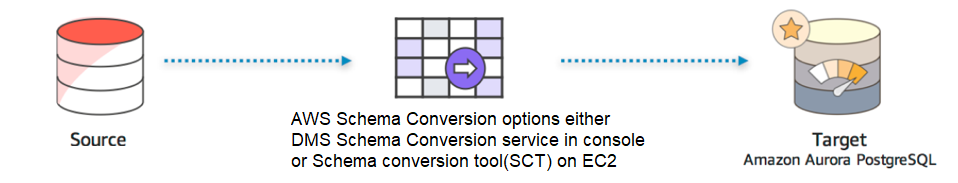

2.Click on the drop-down menu on the top right corner of the screen, and select one of the 20 supported regions for this tutorial:

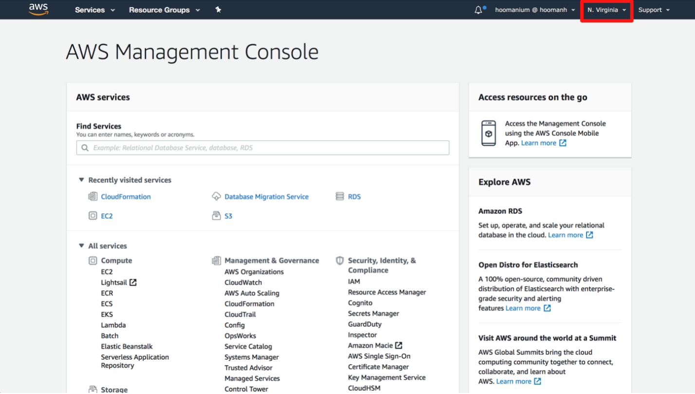


### 1. Create an EC2 key pair


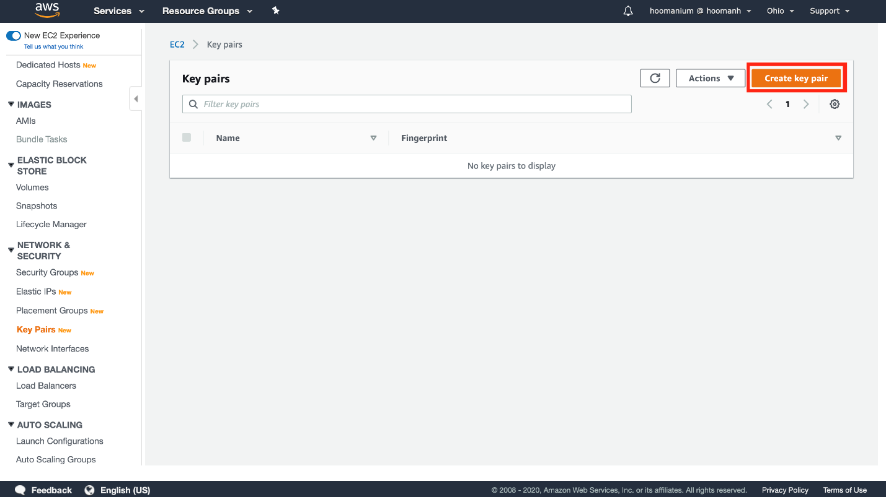

Name the key pair DMSKeyPair, and then click Create. At this point, your browser will download a file named DMSKeyPair.pem. Save this file. You will need it to complete the tutorial.

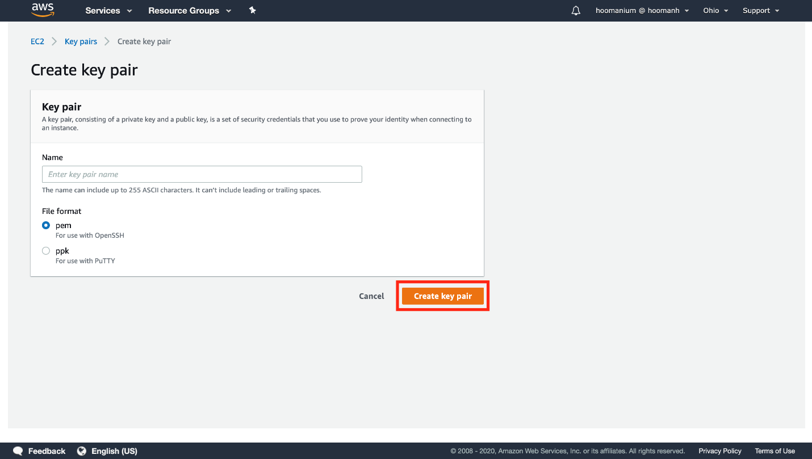


### 2. Configure the AWS environment

In this step, you will use a CloudFormation (CFN) template to deploy the infrastructure for this database migration. AWS CloudFormation  simplifies provisioning the infrastructure, so we can concentrate on tasks related to data migration.
Open the AWS CloudFormation console , and click on Create Stack in the left-hand corner.
```sql
Select Template is ready, and choose Upload a template file as the source template. Then, click on Choose file and upload the DMSWorkshop.yaml . Click Next.
```
Populate the form as with the values specified below, and then click Next.

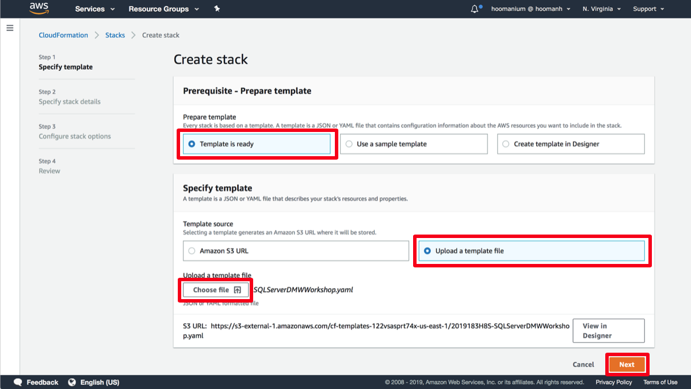

| Input Parameter | Values |
| --- | --- |
| Stack Name | A unique identifier without spaces. |
| MigrationType / Lab Type | Database that you want to migrate (Oracle or SQL Server). |
| EC2ServerInstanceType | An Amazon EC2 Instance type from the drop-down menu. Recommend using the default value. |
| KeyName | The KeyPair (DMSKeypair) that you created in the previous step. |
| RDSInstanceType | An Amazon RDS Instance type from the drop-down menu. Recommend using the default value. |
| VpcCIDR | The VPC CIDR range in the form x.x.x.x/16. Defaults to 10.20.0.0/16 |
| IAMRoleDmsVpcExist | Does your AWS account already have dms-vpc-role(goto IAM>roles & search for "dms-vpc" to check) if this role is not there template will fail-rollback unless you change default Y to N? |

The resources that are created here will be prefixed with whatever value you specify in the Stack Name. Please specify a value that is unique to your account.
On the Stack Options page, accept all of the defaults and click Next.

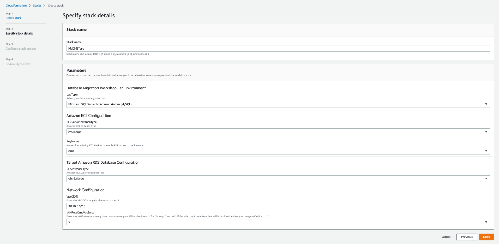

On the Review page, click Create stack.
10.At this point, you will be directed back to the CloudFormation console and will see a status of CREATE_IN_PROGRESS. Please wait here until the status changes to COMPLETE.


11.Once CloudFormation status changes to CREATE_COMPLETE, go to the Outputs section.

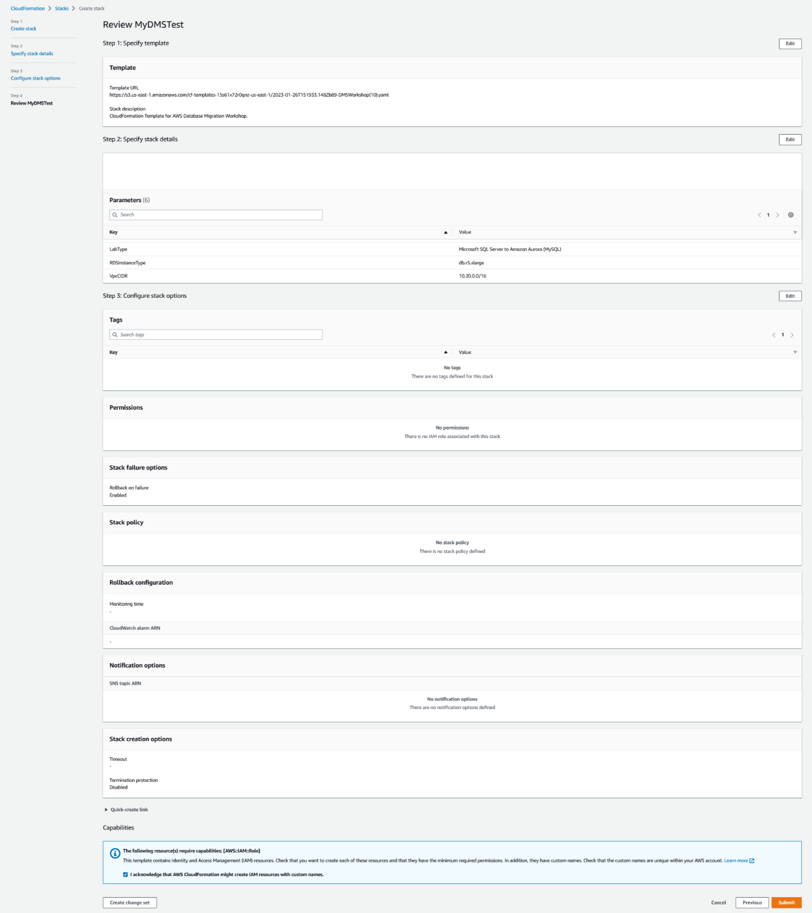


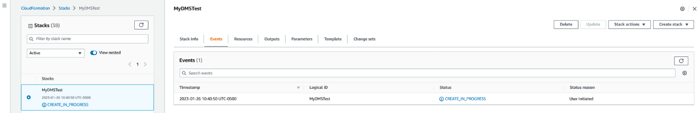

12.Make a note of the Output values from the CloudFormation environment that you launched as you will need them for the remainder of the tutorial:

### 3. Install and configure Kiro / Q CLI


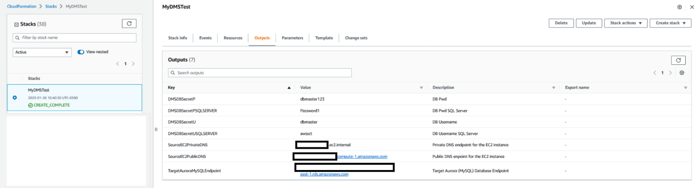


### 3. Install and configure Kiro / Q CLI

From the Workshop Studio tab where you opened the AWS Console window, in the search window at the top enter Session Manager  and select it from the pop up list like below (make sure you are in the right region for your event):

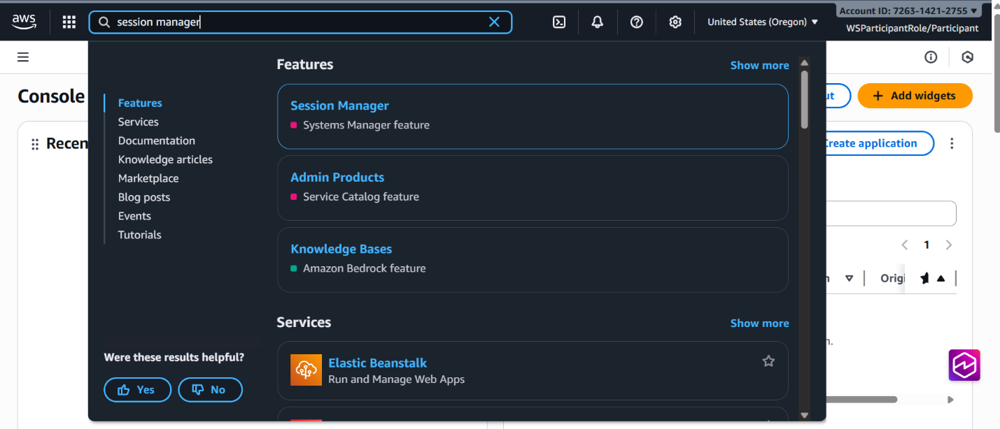

Once Session Manager is open, click on the Configure Preference button or tab.

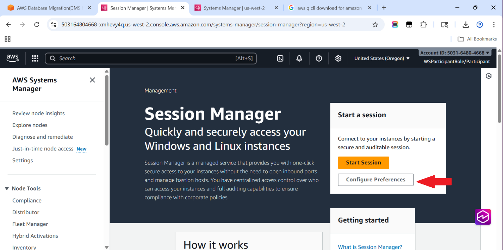

Change preferences - Set Idle session timeout set to 60 minutes then Check box beside "Enable Run As for linux instances" and put your Operating System user name as "ec2-user" click Save at the bottom of the screen like below:

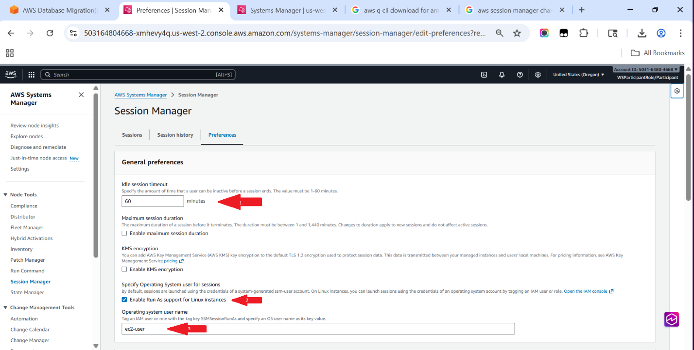

```sql
Select Sessions tab in Session Manager (2 over to the left from Preferences at the top of the page), you'll want to start a new session with the Yellow Start Session button if there is a participant row listed select radio button and click Start session if it isn't there no worries we will create/start one.
```

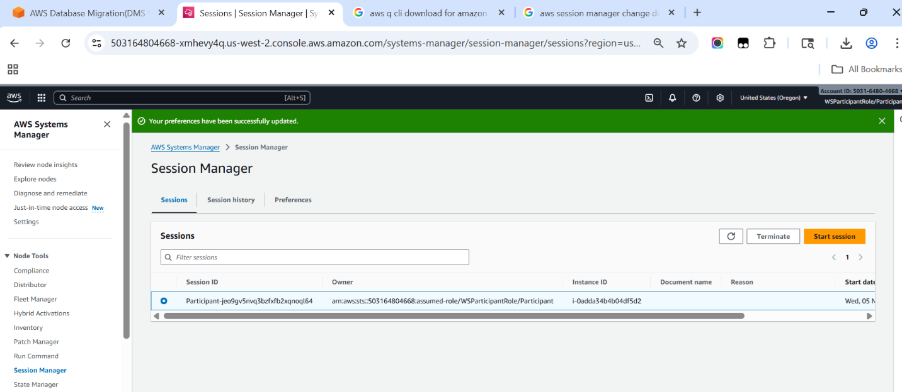

5 You should see 2 instances like screen shot below. Select the EC2LinuxMultiDB% instance and click "Start Session" button. This should open session manager session on another tab.

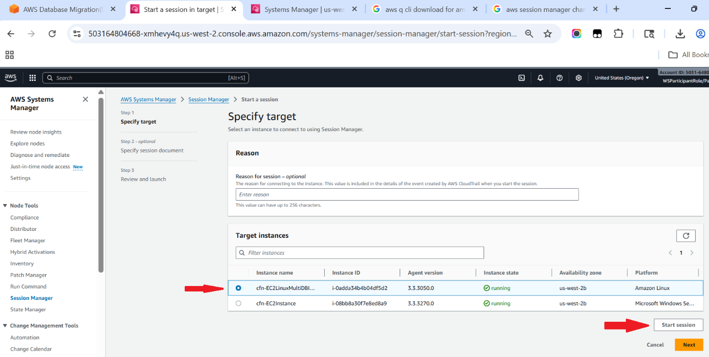

Once connected via system manager type in whoami and it should return ec2-user if not please run sudo su - ec2-user the type "cd" then "pwd" and your path should be '/home/ec2-user/' .

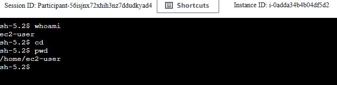

Now let's download and configure Kiro/Q CLI for Linux run the following command and answering yes to any confirmation questions. Note: Kiro/Q will likely output some errors - this is normal.Kiro/Q CLI utilizes Strands, a framework developed by AWS that enables it’s agentic capabilities. Kiro/Q will catch errors, infer the issue, and then rectify it for you. This is expected throughout this workshop.
Note: best to use right click for copy and paste vs. keyboard short cuts as ctrl-c in windows will end your linux session.
1
2
3
4
```bash
curl -fsSL https://cli.kiro.dev/install | bash
export PATH="$HOME/.local/bin:$PATH"
source ~/.bashrc
kiro-cli login --use-device-flow
```
Choose the options to allow Kiro to modify your shell and use the free Builder ID. (note if you have a corp Kiro account you could use Identity Center and log in to that but the free account will have enough credits to complete this workshop. )

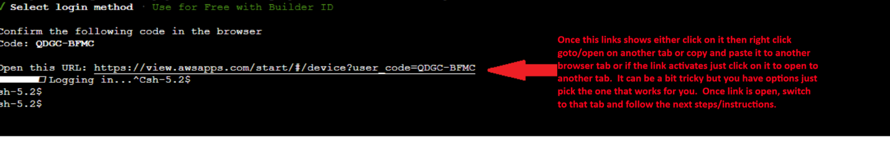

Open the URL provided and login with your free Builder ID (sometimes you have to double click then right click on link to get it to open). If you don't have one simple provide an email address you have access to and create a new account. It will email you a authorization number and you will provide it in the prompt and follow all the steps until it says authorized.

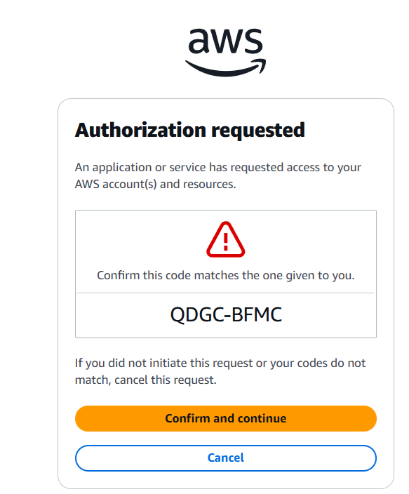

If the Allow Access windows shows up Click Allow Access then you should see a screen like below:

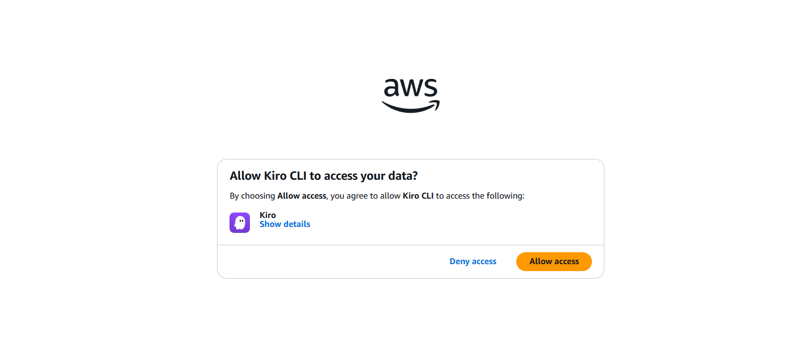

after allow access it will look like below and you can close this table and go back to session manager tab

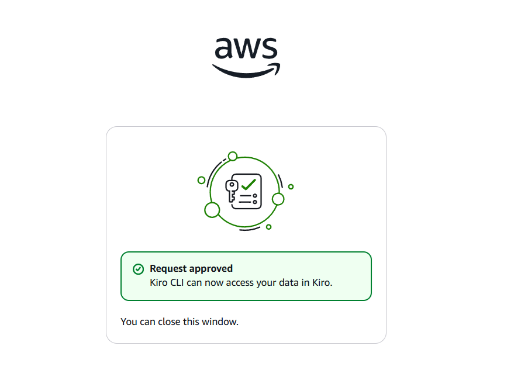

You will return to Kiro/Q CLI prompt window/tab and you should see confirmation of successful login.
Switch back to your command prompt Session manager (should be 1 tab back to the left) then to test Kiro CLI install run command kiro-cli (also below to make it easier to copy) and it should start the Kiro interface which we will want to change the model used for our workshop to Claude Sonnet 4.5 so type command "/model" and use arrow keys to pick Claude Sonnet 4.5 and hit enter. Note: if you get disconnected from Kiro or session ends you'll need to repeat this command again at the start of your session.
1
```bash
kiro-cli
```
1
```bash
/model
```

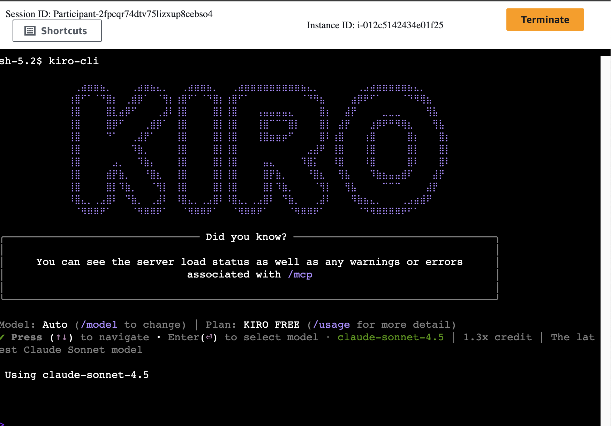

Kiro install and config is complete, now let's move to the next section to start working with our schema conversion then database migration.
When migrating your Microsoft SQL Server database using AWS DMS, you can choose to migrate existing data only, migrate existing data and replicate ongoing changes, or migrate existing data and use change data capture (CDC) to replicate ongoing changes. Migrating only the existing data does not require any configuration on the source SQL Server database. However, to migrate existing data and replicate ongoing changes, you need to either enable MS-REPLICATION, or MS-CDC. In the next part of our workshop we are going to do just that
Get back to the Session Manager window where we were connected to the EC2LinuxMultiDB instance where you completed setting up Kiro/Q CLI a few moments ago. The last command should have been changing the model. Note if the session ended or you were disconnected/froze you will need to reset the model again if it restarts.
Using the Kiro/Q prompt like below have Kiro/Q research the databases in your account and region Note be sure the region matches with the command below: This should find 2 databases and a S3 bucket. If you get prompted for "Allow this action" or anything with a trust or confirm please do so.
1
Find the AWS region this EC2 instance is running in using IMDSv2 (the newer metadata service version).
Any Prompts that Kiro/Q asks for t for trust or y for yes proceed please select Trust and if it asks something like Shell requires approval if you say Entire tool it will save you from having to approve each command run. here's an example Allow this action? Use 't' to trust (always allow) this tool for the session. [y/n/t]: pick t and enter. You will also have to confirm full commands or Trust Entire tool by hitting enter when asked for Kiro to proceed on and action/command please do so
Kiro/Q should come back with the region of your event where the ec2 instance is running. Next use the following prompt with Kiro/Q
1
Using the AWS region you found, tell me about the RDS databases in this account. They may start with "cfn" in the name. There is also a Windows EC2 instance (name may start with "cfn") running SQL Server that I want to include as a possible source. Its connection details are in Secrets Manager, along with the RDS connection info. Also, find the S3 buckets in this region with a bucket name starting with "dms-sc".
It should look something like below just (note your region may vary from screenshot)

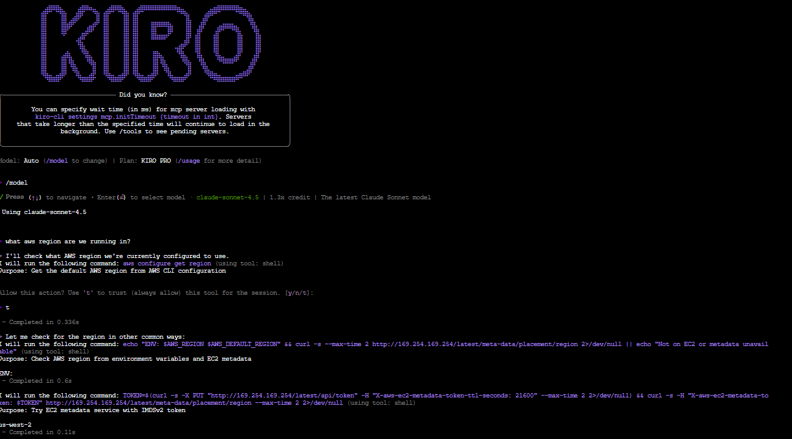

Next provide the prompt below so we complete the prerequistes on the source database. Note this will install SQL Server query tools and save your sql script to a local file and run it. If you get prompted for Allow this action or anything with a trust or confirm please do so.
Kiro/Q will respond with information on connecting to SQL Server if asked say t for trust or Y for yes and let it progress. It should take the steps to connect to the sql server then ask you for your SQL script. When it does paste the script below and have Kiro run it.
```sql
--Set master database context
use [master]
GO
--Add the awssct login to the sysadmin server role - required for replication
ALTER SERVER ROLE [sysadmin] ADD MEMBER [dbadmin]
GO
--Set the recovery model to full for dms_sample - required for replication
ALTER DATABASE [dms_sample] SET RECOVERY FULL WITH NO_WAIT
GO
--Configure this SQL Server as its own distributor
exec sp_adddistributor @distributor = @@SERVERNAME, @password = N'Password1'
exec sp_adddistributiondb @database = N'distribution', @data_folder = N'C:\Program Files\Microsoft SQL Server\MSSQL16.MSSQLSERVER\MSSQL\DATA', @log_folder = N'C:\Program Files\Microsoft SQL Server\MSSQL16.MSSQLSERVER\MSSQL\DATA', @log_file_size = 2, @min_distretention = 0, @max_distretention = 72, @history_retention = 48, @security_mode = 1
GO
RECONFIGURE
go
--Change context to the distribution database
use [distribution]
GO
--Configure replication
```
if (not exists (select * from sysobjects where name = 'UIProperties' and type = 'U '))
```sql
create table UIProperties(id int)
```
if (exists (select * from ::fn_listextendedproperty('SnapshotFolder', 'user', 'dbo', 'table', 'UIProperties', null, null)))
```sql
EXEC sp_updateextendedproperty N'SnapshotFolder', N'C:\Program Files\Microsoft SQL Server\MSSQL16.MSSQLSERVER\MSSQL\repldata', 'user', dbo, 'table', 'UIProperties'
```
else
```sql
EXEC sp_addextendedproperty N'SnapshotFolder', N'C:\Program Files\Microsoft SQL Server\MSSQL16.MSSQLSERVER\MSSQL\repldata', 'user', dbo, 'table', 'UIProperties'
GO
RECONFIGURE
go
exec sp_adddistpublisher @publisher = @@SERVERNAME, @distribution_db = N'distribution', @security_mode = 1, @working_directory = N'C:\Program Files\Microsoft SQL Server\MSSQL16.MSSQLSERVER\MSSQL\repldata', @trusted = N'false', @thirdparty_flag = 0, @publisher_type = N'MSSQLSERVER'
GO
--- Now let us enable MS-CDC for non primary key tables
USE dms_sample;
GO
EXEC sys.sp_cdc_enable_db
GO
EXECUTE sys.sp_cdc_enable_table
@source_schema = N'dbo',
@source_name = N'mlb_data',
@role_name = N'dbadmin';
GO
EXECUTE sys.sp_cdc_enable_table
@source_schema = N'dbo',
@source_name = N'nfl_data',
@role_name = N'dbadmin';
GO
EXECUTE sys.sp_cdc_enable_table
@source_schema = N'dbo',
@source_name = N'nfl_stadium_data',
@role_name = N'dbadmin';
GO
EXECUTE sys.sp_cdc_enable_table
@source_schema = N'dbo',
@source_name = N'corp_customers',
@role_name = N'dbadmin';
GO
EXECUTE sys.sp_cdc_enable_table
@source_schema = N'dbo',
@source_name = N'product_sale_regions',
@role_name = N'dbadmin';
GO
EXECUTE sys.sp_cdc_enable_table
@source_schema = N'dbo',
@source_name = N'product_sales',
@role_name = N'dbadmin';
GO
EXECUTE sys.sp_cdc_enable_table
@source_schema = N'dbo',
@source_name = N'student_results',
@role_name = N'dbadmin';
GO
ALTER DATABASE [YoDA] SET RECOVERY FULL WITH NO_WAIT
GO
```
Kiro/Q will save the script to a file then build the steps necessary to execute it at the end it should say something like
> Perfect! The SQL script executed successfully. Here's what was configured:
Completed Setup:
✓ Added dbadmin to sysadmin role
✓ Set dms_sample database to FULL recovery model (required for replication)
✓ Configured SQL Server as its own distributor
✓ Created distribution database
✓ Configured replication settings
✓ Enabled MS-CDC (Change Data Capture) on the dms_sample database
✓ Enabled CDC on 7 tables:
- mlb_data
- nfl_data
- nfl_stadium_data
- corp_customers
- product_sale_regions
- product_sales
- student_results
✓ Set YoDA database to FULL recovery model
✓ Started CDC capture and cleanup jobs
Note: There's a warning about the database master key in the distribution database. This is informational and won't block DMS operations, but you may want to create one for enhanced
security if needed.
Your SQL Server source is now ready for DMS schema conversion and database migration with CDC enabled for ongoing replication.
Now let move on to the next section of picking your target. note you'll still use Kiro so keep that tab/connection open.

Note: if Kiro had permission issue creating the migration project due to lack of iam-PassRole you will need to just use the prebuilt one. Kiro can't fix that level of IAM issue. Please let your AWS contact know you hit this issue and provide the error message

Kiro Setup and Config Target
This section demonstrates how we will use Kiro/Q to build our DMS resources and simplify data migration/modernization using it.
Return the the Sessions Manager window in the AWS Console, where we used to configure our source databases.
Now let's have Kiro/Q build our SC & DMS migration resources using the prompts below. Note: it will cycle through existing resources which may take a bit.
First we need to prepare our MySQL target with the script below. Have Kiro connect and run it for you.
1
2
3
4
5
6
7
8
9
10
11
12
13
14
15
16
17
18
19
20
21
22
23
24
Connect to the Aurora MySQL database in this region using credentials from Secrets Manager. Run the following SQL script to prepare the MySQL target for DMS migration:
```sql
GRANT CREATE ON *.* TO 'dbadmin';
GRANT ALTER ON *.* TO 'dbadmin';
GRANT DROP ON *.* TO 'dbadmin';
GRANT INDEX ON *.* TO 'dbadmin';
GRANT REFERENCES ON *.* TO 'dbadmin';
GRANT SELECT ON *.* TO 'dbadmin';
GRANT CREATE VIEW ON *.* TO 'dbadmin';
GRANT SHOW VIEW ON *.* TO 'dbadmin';
GRANT TRIGGER ON *.* TO 'dbadmin';
GRANT CREATE ROUTINE ON *.* TO 'dbadmin';
GRANT ALTER ROUTINE ON *.* TO 'dbadmin';
GRANT EXECUTE ON *.* TO 'dbadmin';
-- only for MySQL <8.0 GRANT SELECT ON mysql.proc TO 'awssct';
GRANT INSERT, UPDATE ON AWS_SQLSERVER_EXT.* TO 'dbadmin';
GRANT INSERT, UPDATE, DELETE ON AWS_SQLSERVER_EXT_DATA.* TO 'dbadmin';
GRANT CREATE TEMPORARY TABLES ON AWS_SQLSERVER_EXT_DATA.* TO 'dbadmin';
GRANT CREATE TEMPORARY TABLES ON *.* TO 'dbadmin';
-- MySQL <8 code GRANT INVOKE LAMBDA ON *.* TO 'awssct';
GRANT AWS_LAMBDA_ACCESS TO 'dbadmin';
GRANT INSERT, UPDATE ON AWS_ORACLE_EXT.* TO 'dbadmin';
GRANT INSERT, UPDATE, DELETE ON AWS_ORACLE_EXT_DATA.* TO 'dbadmin';
grant INSERT ON aws_sqlserver_ext.* to 'dbadmin';
grant UPDATE ON aws_sqlserver_ext.* to 'dbadmin';
```
Next Let's have Kiro evaluate what resource we need for our migration. Run only one of the prompts below based on your source
**Oracle TO MySQL**
**SQL Server TO MySQL**
Oracle to MySQL use this prompt
1
I want to migrate the DMS_SAMPLE schema from Oracle to MySQL using DMS Schema Conversion (not classic SCT). What resources do we need to create? Prompt me before creating anything. Create new migration project, instance profiles, data providers (SSL not required), endpoints, and DMS task. Reuse the existing S3 bucket (starts with "dms-sc") and the existing IAM role dms-migration-role-cfn.
Kiro/Q should list out the resources needed and asks for next steps and guidance please provide the prompt below noting Kiro will likely have a good list to build but we have specific instructions we'll want to provide below so use the prompt below
If Kiro/Q created the schema migration objects (instance profile, data providers & migration project remove those from below and have it create the dms task components. )
**Oracle TO MySQL**
**SQL Server TO MySQL**
For Oracle to MySQL use
1
```sql
Use the existing replication instance. Create new instance profile, data providers (SSL not required), migration project, and DMS task. Migrate all tables and objects in the Oracle DMS_SAMPLE schema to MySQL. Task settings: full load + CDC, "do nothing" for target table preparation, batch optimized apply enabled, create recovery table on target enabled, Maximum LOB size 102400. Add a transformation rule to lowercase schema, table, and column names on the target. For S3, use the bucket starting with "dms-sc". For the IAM role in data providers and migration project, use dms-migration-role-cfn. Create all resources but do not start the DMS task.
```
It will likely show errors and ask some t for trust to resolve issues but after working through them you should see something like below: Next we'll go into the AWS DMS console to verify these components are built for you.
> Perfect! All resources have been created successfully. Here's a summary:
## ✅ DMS Resources Created Successfully
### **1. Instance Profiles (2)**
- **oracle-source-profile** - ARN: arn:aws:dms:xx-xxxx-#:111111111111:instance-profile:MBXGA4I3KJCEJHCEYMFIC5FTNU
- **mysql-target-profile** - ARN: arn:aws:dms:xx-xxxx-#:111111111111:instance-profile:K4FW5APOQFDF3FLFNFG7B3PZYM
### **2. Data Providers (2)**
- **oracle-source-dms_sample** - ARN: arn:aws:dms:xx-xxxx-#:111111111111:data-provider:P3OYGTV2C5GKHKMYJS5HH4PK74
- Engine: Oracle
- Server: cfn-sourceoracledb.ctjmpm8fvgek.xx-xxxx-#.rds.amazonaws.com:1521
- Database: ORACLEDB
- **mysql-target-dms_sample** - ARN: arn:aws:dms:xx-xxxx-#:111111111111:data-provider:SL7QXGBT5ZEJPJLNTIKJPPPOEI
- Engine: MySQL
- Server: cfn-auroramysqlcluster-cvtm9b4ikxsn.cluster-ctjmpm8fvgek.xx-xxxx-#.rds.amazonaws.com:3306
- Database: AuroraDB
- SSL Mode: require
### **3. Migration Project**
- **dms_sample-oracle-to-mysql** - ARN: arn:aws:dms:xx-xxxx-#:111111111111:migration-project:4OERLYRKLBHU7FAZU45QJ5YLVU
- S3 Bucket: s3://dms-sc-111111111111-cfn
- IAM Role: dms-migration-role-cfn
- Transformation rules: lowercase schema, tables, and columns
### **4. DMS Endpoints (2)**
- **oracle-source-dms_sample-endpoint** - ARN: arn:aws:dms:xx-xxxx-#:111111111111:endpoint:3JB7CPCQBFBMJAJU6AQF4I67WY
- Type: SOURCE
- Using Secrets Manager: DMSDBSecret-oraclesource-cfn
- **mysql-target-dms_sample-endpoint** - ARN: arn:aws:dms:xx-xxxx-#:111111111111:endpoint:SLZHT7TJLZEVDGQP4GQWJMBXIY
- Type: TARGET
- SSL Mode: require
- Using Secrets Manager: DMSDBSecret-AuMySQL-cfn
### **5. DMS Replication Task**
- **yoda-dms_sample-to-mysql-task** - ARN: arn:aws:dms:xx-xxxx-#:111111111111:task:S3YMFIKEVVFQ7OYHCSBMYU2J54
- Status: creating (not started)
- Migration Type: full-load-and-cdc
- Target Table Prep Mode: DO_NOTHING
- Replication Instance: cfn-dmsreplication
Table Mappings:
- Select all tables from dms_sample schema excluding STUDENT_RESULTS
- Transform schema name to lowercase (DMS_SAMPLE → dms_sample)
- Transform table names to lowercase
- Transform column names to lowercase
The task is created but NOT started as requested. You can start it from the AWS DMS console when ready!
Kiro/Q has built an initial cut of our resources now we can switch to the AWS console and complete the Schema Conversion and start our DMS task after creating all the objects we want to migrate. Please proceed to the next section
If above was successful please proceed to next section
We have had random issues with this approach if you had some issues please try the options below to correct them or have Kiro/Q try to fix problems you run into. If everything worked then skip below and move on to next section
Note: if Kiro had permission issue creating the migration project due to lack of iam-PassRole you will need to just use the prebuilt one. Kiro can't fix that level of IAM issue. Please let your AWS contact know you hit this issue and provide the error message
If Kiro had Secret Manager permission issue trying to create migration project please try this prompt to Kiro/Q to try to work around it
1
```sql
Create the migration project that failed earlier using the instance profile and data providers you already created. For Secrets Manager, use DMSDBSecret-AuMySQL-cfn as the target secr
```

### 6. Create instance profiles

**Note We will be using the in console AWS DMS Schema Conversion project
This section should be automated by Kiro/Q. We'll check to see if it successfully created resources and if so we'll skip to the next section
Proceed to the AWS Console and Select DMS service either by typing it into the Search bar at the top or clicking AWS Database Migration Service (DMS)
```sql
Select Instance Profiles link on the left hand menu right click and open on new tab and switch to that tab, there should be prebuilt Instance Profile and you should see one that Kiro/Q built for you like the screen shot below. Note: the screen shot below has multiple scenarios that have been run so your won't match and Kiro sometimes varies on naming, thus as long as you see one for your scenario you are good to move to the next section.
```

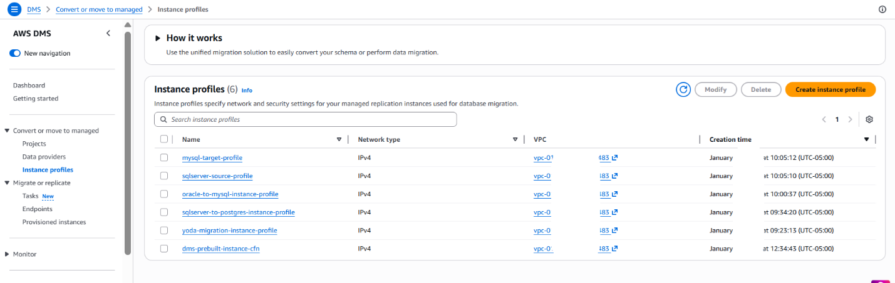

If Kiro/Q successfully built an instance profile. Please proceed to the next section. You don't need to do the part below unless you want the experience
Manual steps below only if you want to get the experience or Kiro/Q had issues
Just for reference you can build an Instance profile if you want to get the experience. Click on Create Instance profile button on the right as shown below. (Why/What note: instance profiles are used to specify network and security settings for the serverless environment where your migration project runs). Provide the information on the screen as shown in the table below.
```sql
Create Instance Profile inputs
```
| Parameter | Value |
| --- | --- |
| Name | myinstanceprofile or your source-target |
| Description | Leave blank or put in whatever you'd like |
| Network Type | IPV4 default |
| Virtual Private Cloud(VPC) | Pick the one with DmsVpc in the name not the default |
| Subnet group | should be only 1 option with dms-subnet in the name if you don't see one you have wrong vpc go back and pick one with dms in the name |
| VPC Security groups | Check the one with InstanceSecurityGroup in the name (note the default security group is also selected by default and we can keep that one so you end up with 2 as shown in the image below) |
| Assign Public IP | Select/click NO not the default |
| **Tags ** | Leave blank |
| **Additional settings ** | Leave blank |

Click Create Instance Profile Button at bottom
It should look something like below

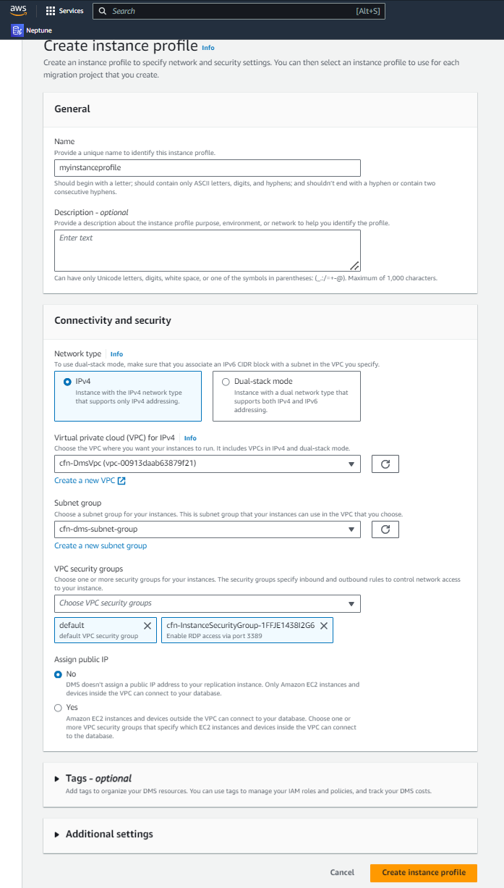


### 7. Configure data providers

Now that you created an Instance Profile, let's check data providers .
This section should be automated by Kiro/Q. We'll check to see if it successfully created resources and if so we'll skip to the next section
Within AWS DMS Console Click/Select Data Provider on the left hand side of the screen. It is just below Instance profiles you just worked with. See image below for reference (Note existing Data Providers you see will vary from screenshot below. This is expected).

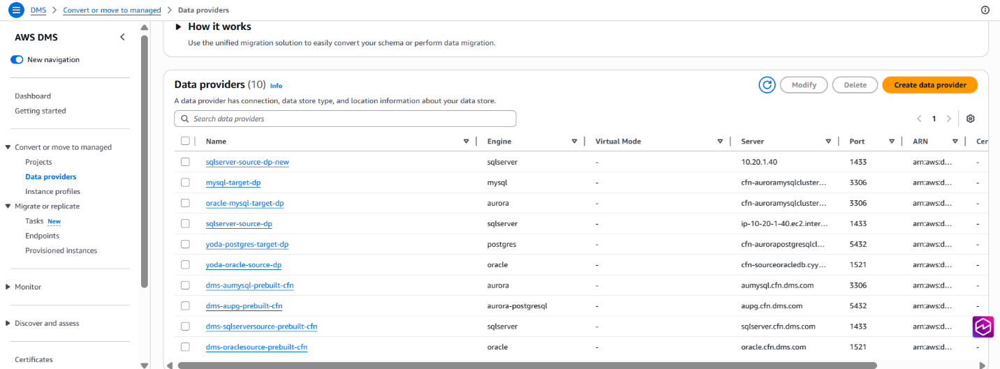

You should see a few prebuilt data providers are already(created with prebuilt in the name). You should also see 2 created by your Kiro/Q prompt. Note: the screen shot below was taken supporting multiple scenarios that have been run so yours will look different and Kiro sometimes varies on naming, thus as long as you see ones for your scenario you are good to move to the next section.


If Kiro/Q successfully built the data providers, Please proceed to the next section. You don't need to do the part below unless you want the experience
Manual steps below only if you want to get the experience or Kiro/Q had issues
2a. If you want the experience or if Kiro/Q had an issue. Click the Create Data Provider button right hand side of the screen as shown in image below (Why/What note: data provider stores a data store type and the location information about your database. After you add a data provider to your migration project, you provide the database credentials from AWS Secrets Manager. AWS DMS uses this information to connect to your database)
Provide data provider inputs like the table and image show below picking the source db you are migrating for your workshop and click create data provider button
| Parameter | Value |
| --- | --- |
| Name | mydataprovider or source-target |
| Purpose | Select Schema conversion |
| Engine Type Dropdown | Select your source database engine either Oracle or SQL Server |
| **Virtual Mode ** | leave unchecked |
| RDS or Enter Manual Radio Button/Selection | Enter Manually (note for Oracle you could use the RDS option if you wanted it would save some work) |
| Server name | Provide either the RDS Oracle Endpoint or EC2 instance Private DNS name (Note: our sql server source is on the ec2 instance we connected to earlier something like ip-10-20-1-21.ec2.internal). Both are found on the AWS CloudFormation service  in Stack "cfn" on the Output table in your account if you don't see cfn check your AWS region |
| Port | Oracle source enter 1521 or for SQL Server source enter 1433 or Postgresql enter 5432 |
| Oracle Only SID | ORACLEDB |
| Oracle Only ASM | leave blank |
| non-Oracle Database Name | SQL Server enter dms_sample or for Postgresql enter AuroraDB |
| Secure Socket Layer SSL radio button | None may not be default |
| Tags | leave blank |
| Anything else | leave blank or take default |

**Oracle**
**SQLServer**
For Oracle source it will look like screenshot below. For other sources like SQL Server be sure to pick the source you worked on in the earlier section.

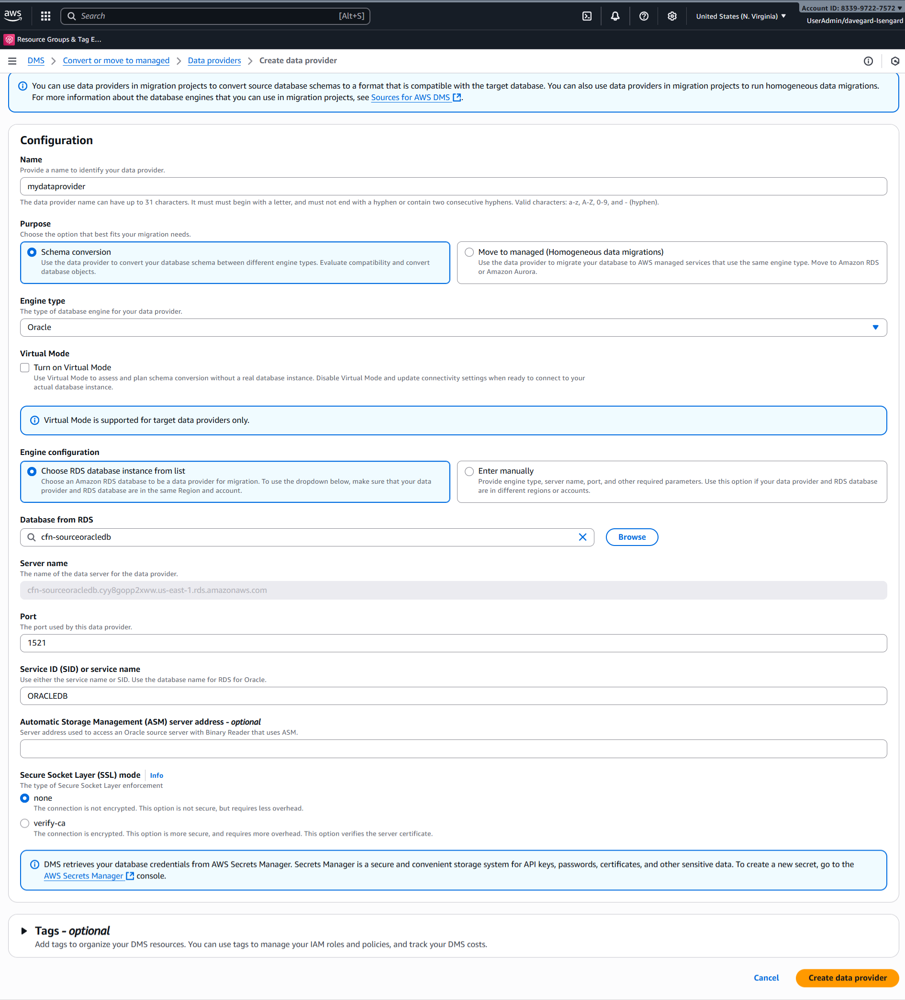

Once the data provider is created, your screen should look similar to the image below. Note some names maybe slightly different.

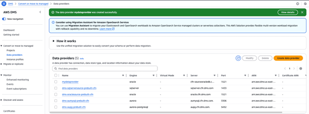

Note: due to time constraints we'll skip this step for the target and use the prebuilt one but in a real scenario one would repeat step 3 for Aurora Postgresql target just change the name to mydataprovider-target. please proceed to the next section

### 8. Create migration project and convert schema

Note: we have pre-built instance profile, data providers, & migration project you are welcome to use those if you get stuck or way behind however the plan will be for you to use the ones Kiro/Q created for you or the ones you created yourself
```sql
Select Migraton project from the left hand side of the screen. It should look something like the screen below with a few prebuilt ones(prebuit in the name) and one created by KiroQ. Note for Oracle you should see Oracle in the name and same for SQL Server. Note: the screen shot below has multiple scenarios that have been run so yours won't match and Kiro sometimes varies on naming, thus as long as you see one for your scenario you are good to proceed.
```

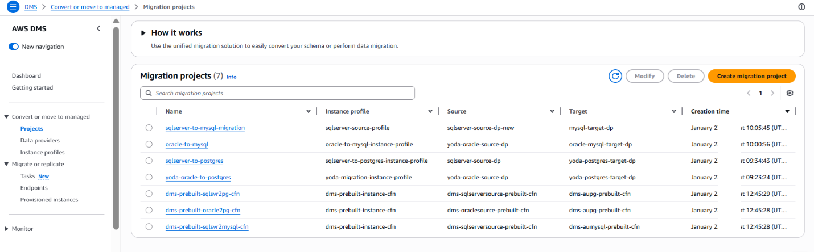

```sql
Select/Click on the migration project Kiro/Q built on the right that matches your source (Oracle, SQL Server, etc) and target scenario (likely the one Kiro built for you) and goto/click on the Schema Conversion tab.
```

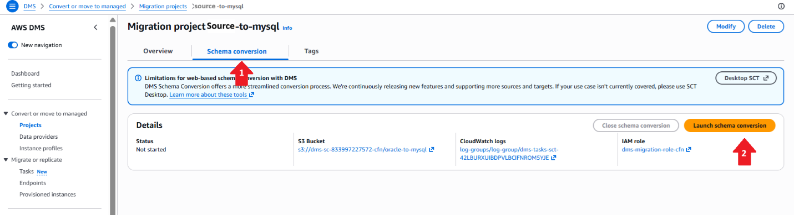

```sql
Select/click Launch Schema Conversion button like what's shown below and click the confirm window when it pops up. It will take a few minutes for this to spin up.
```


In the Schema Conversion tool screen source side (left) uncheck the top radio button on the source side where is says Server then traverse down to schemas by clicking on down arrows (note if it still is loading you may need to refresh your browser)
For Oracle select down arrows until you see schemas then check the box beside "DMS_SAMPLE" then click checkbox then click on the word DMS_SAMPLE and the Actions button should activate / enable. Note if you don't click on name action button stays greyed out
For SQL Server select down arrows until you see databases click on "dms_sample" then select "dbo" check box then click on the word "dbo" which will activate / enable the Actions button. Note if you don't click on name action button stays greyed out
**Oracle**
**SQLServer**
For Oracle it should look something like the image below when you are done.

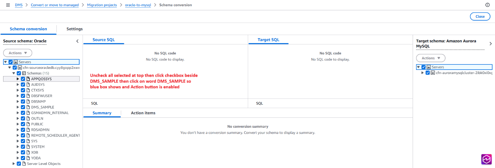


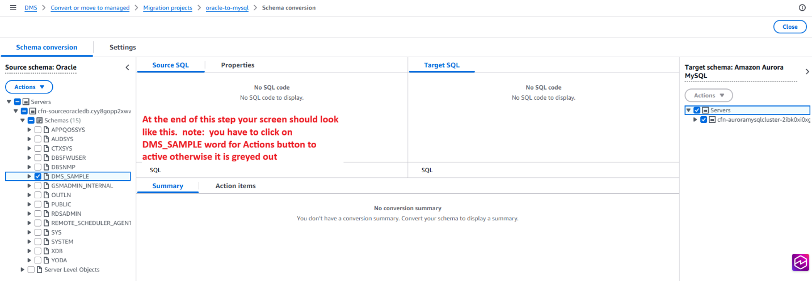

Let's run the assessment from the drop down. Click Assess on the confirmation pop up window. this will take a few minutes to run to get started it should look something like below (for SQL Server it would show dms_sample-->dbo)

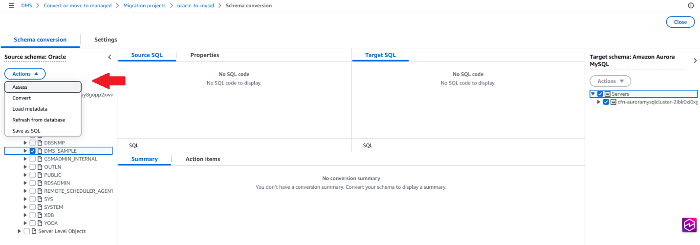

**Oracle**
**SQLServer**
Once Assessment is complete, for Oracle it should look something like the image below: Noting ~100% of Database objects convert automatically and ~60% of the code object convert automatically You can click on the Action Items button/tab and see specific code challenges.

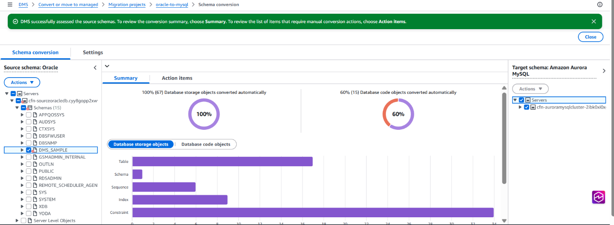

Now Select/click on the Export results button in the bottom middle/right and select PDF on the export confirmation pop up click Export to PDF. At the top of the screen you'll see a green bar with the PDF file being uploaded to S3 and the S3 button on the far top right to open the S3 object and download it. For the sake of time we'll skip downloading it but if you click on the S3 button and on that tab click download it will download to your desktop and it would look like the screen shot below
**Oracle**
**SQLServer**
For Oracle it should look something like the image below:

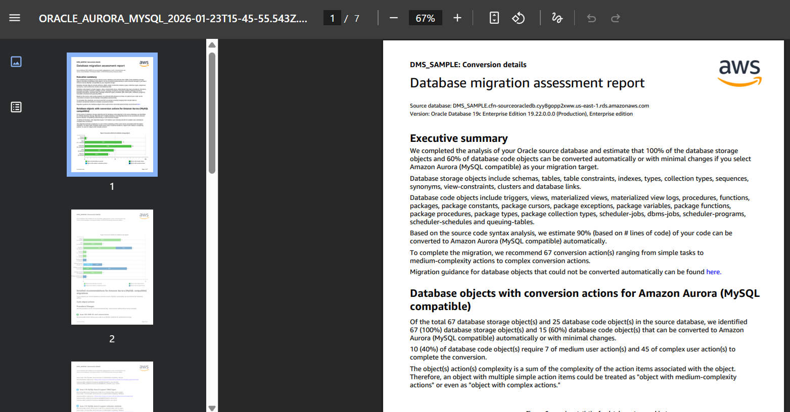

Now select Convert on the Actions button on the left hand side this will convert the database object in SC to the the target database but note it does not actually build them there until we do the next step of apply.
**Oracle**
**SQLServer**
then once convert is done it will look like below for Oracle. The database objects should now show on the target drop down on right hand side of screen.

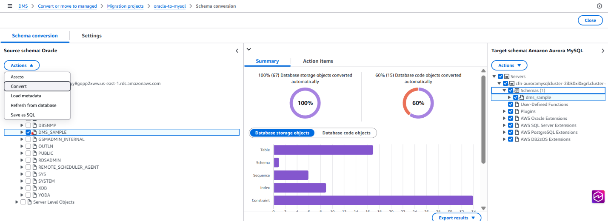

Let's Apply the changes to the target database on the right hand side of screen click on Servers and drill down until you get to Databases/Schemas and Select/click on the word Schema this will activate the Actions button. If schema names show pick DMS_SAMPLE for Oracle or dms_sample_dbo for Sql Server once Actions button activates once you click on Schema or database name with the check box beside it and then click Select/click "Apply Changes" when the confirmation window pops up select Apply.
**Oracle**
**SQLServer**
then once applied/done it will look like below for Oracle note this is with the Actions tab not the summary tab in the middle thus yours may look different in middle. The database objects should now show on the target drop down on right hand side of screen.

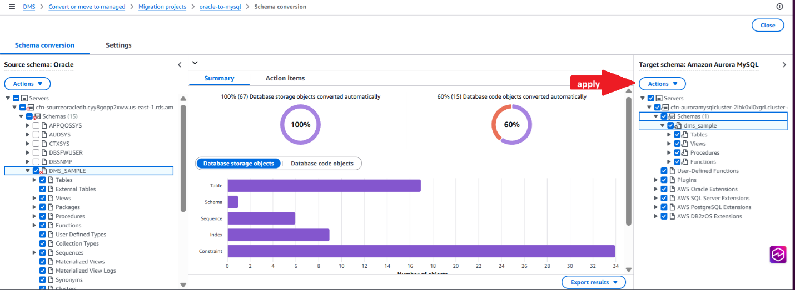

Congratulations!! you converted your source schema to your target database.
Now you are probably asking what about the objects that didn't automatically convert. Many of them still built and they will need to be validated on the target side or they will need to be worked on outside of the Schema Conversion tool. For the scope of this workshop we will leave these issues for another time as there's alot of detailed work and discussion converting existing logic and we have a limited time together today. Let's move on and move the data over .
Now please proceed to Part 2 Data Migration Part 2 Data Migration

## Part 2 — Data Migration

Please note that you need to complete the steps described in Schema Conversion section as a pre-requisite for this part.
This section will demonstrate how you can use the AWS Database Migration Service to migrate data from the source database to the target Amazon Aurora (MySQL). Additionally, you will use AWS DMS to continually replicate database changes from the source database to the target database.
AWS DMS doesn't migrate your secondary indexes, sequences, default values, stored procedures, triggers, synonyms, views, and other schema objects that aren't specifically related to data migration. To migrate these objects to your Aurora MySQL target, we used the AWS Schema Conversion Tool in the previous section.

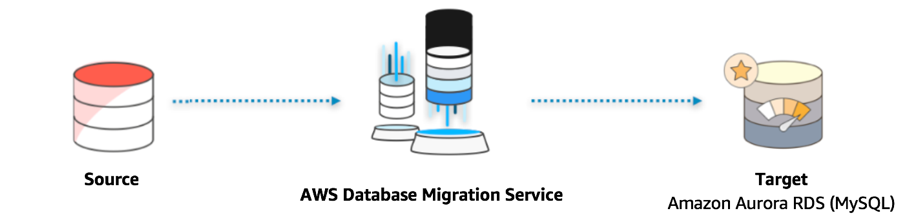


### 9. Configure the target database

During the full load process, AWS DMS as default does not load tables in any particular order, so it might load child table data before parent table data. As a result, foreign key constraints might be violated if they are enabled. Also, if triggers are present on the target database, they might change data loaded by AWS DMS in unexpected ways. To overcome this, we drop the constraints on the target database.
Using Kiro / Gen AI Agent approach (note manual approach is down below if you want to use it but only do 1 or the other not both)
Go back/Return to Session manager session where we ran Kiro instructions earlier. Note if your session died you will need to restart kiro-cli and reset you model again as well as reorient Kiro which region and database resources are available. Details on this are covered in getting started
Once back in Kiro run the following prompt
1
Connect to the Aurora MySQL database in this region using credentials from Secrets Manager. I have a SQL script to run to prepare it for the DMS task you created earlier.
Provide the script below for the source database you selected. Note: we are dropping constraints as DMS full load is table by table.
For Oracle Source expand here
For SQL Server Source expand here
For either source at the end Kiro should be able to connect to MySQL and run the specific script. Here's a sample screen shot of Kiro running MySQL script for SQL Server source. Oracle is similar just no foreign keys.

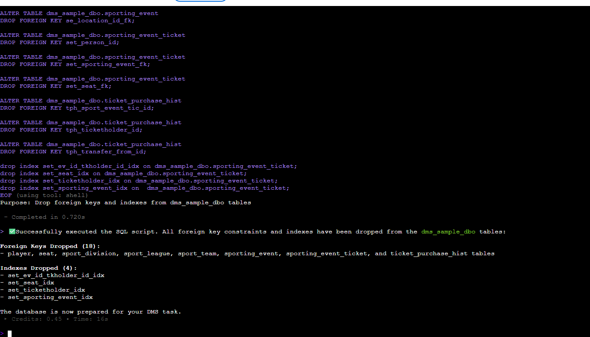

Non-Kiro/Q method where you do it manually. If you successfully used Kiro you can skip these instructions and got the next section
Non-Kiro/Q method where you do it manually. If you successfully used Kiro you can skip this section unless you want the experience.
Connect to the Windows EC2 instance. If you need help with that please see instructions at Connect to Windows EC2
Open MySQL Workbench 8.0 CE used earlier to add permissions needed for Aurora MySQL as a DMS target.

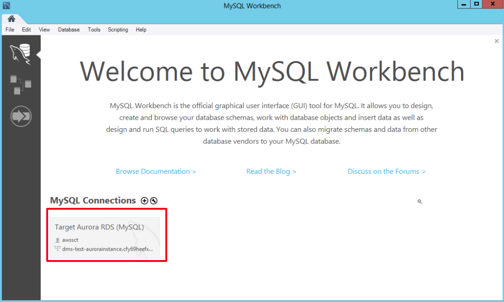

In this step you are going to drop the foreign key constraint from the target database:
From within MySQL Workbench, open a query window and copy and paste the code below into the query window and execute.
Note: expand only for the source in your scenario you can skip the other sources.
For Oracle Source expand here
For SQL Server Source expand here
```sql
Execute the script. the results should look similar to the window below is for SQL Server. Oracle would be shorter.
```

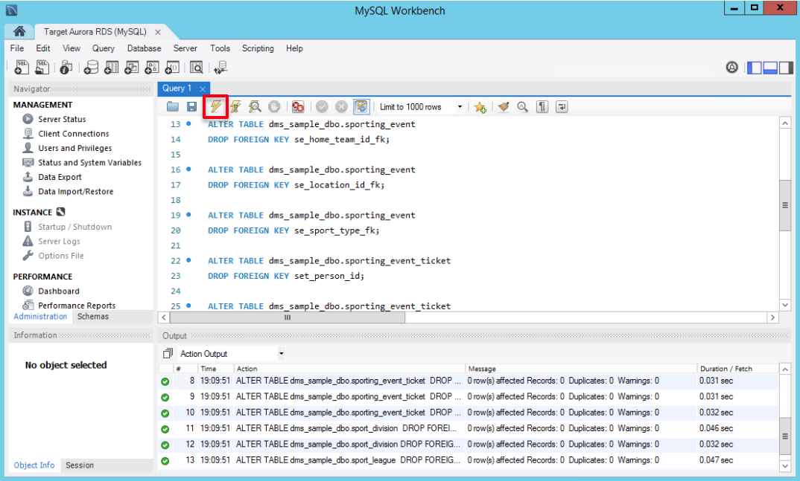


### 10. Create a DMS replication instance

The following illustration shows a high-level view of the migration process.

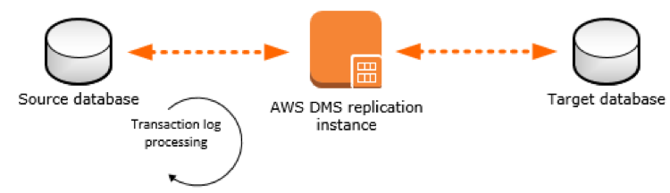

An AWS DMS replication instance performs the actual data migration between source and target. The replication instance also caches the transaction logs during the migration. The amount of CPU and memory capacity of a replication instance influences the overall time that is required for the migration.
1.Navigate to the Database Migration Service (DMS) console  or type DMS in the search bar top left part of screen.
On the left-hand menu click on Provisioned Instances. This will launch the Replication instance screen.
Notice we've already created a DMS Replication instance for you so you can either skip this section or if you want to get the experience of building a DMS replication instance please proceed.
If you are pressed for time please use existing replication instance and if you have time at the end come back and manually build one.
Click on the Create replication instance button on the top right side.

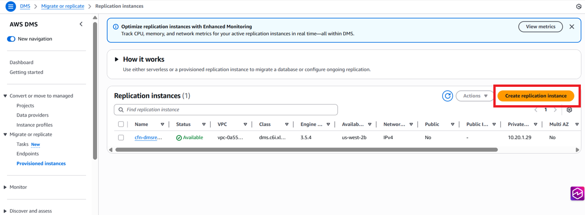

5.Enter the following information for the Replication Instance. Then, click on the Create button.
| Parameter | Value |
| --- | --- |
| Name | DMSReplication-myinitials |
| Descriptive Amazon Resource name(ARN) | leave blank |
| Description | Optional or Replication server for Database Migration |
| Instance Class | dms.c5.xlarge |
| Allocated storage (GB) | 50 |
| Engine version | Leave the default value |
| High Availability/Multi-AZ | Dev or Test workload(Single-AZ) |
| Network Type | take default IPv4 |
| VPC | VPC ID with DMSVpc in the name need to change the drop down |
| Replication Subnet Group | select the one with DMS in the name |
| Publicly accessible | No/unchecked |
| Advanced -> VPC Security Group(s) | default |
| Maintenance | default no need to open this section |
| Kerberos authentication - optional | default no need to open this section |
| Tags - optional | default no need to open this section |


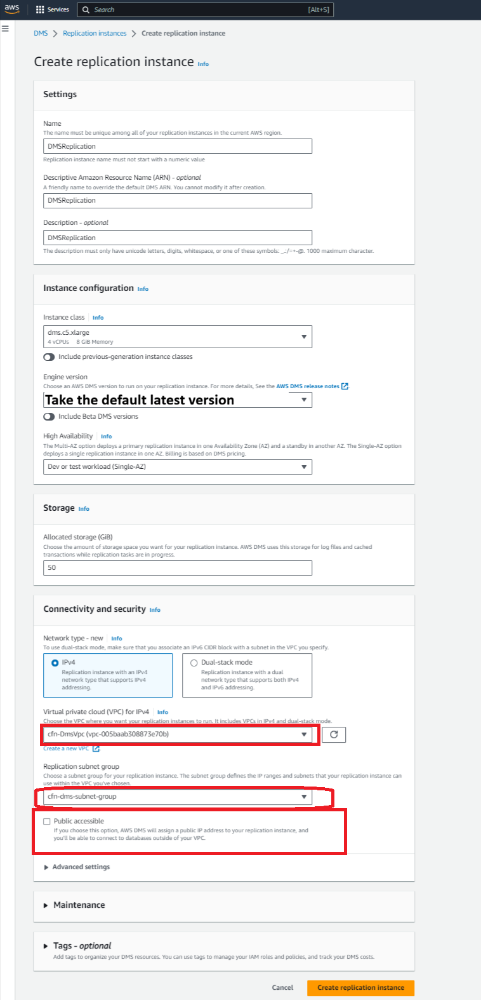

If you get an error The IAM Role arn aws iam ########## role dms-vpc-role is not configured properly. Click Cancel and repeat steps above and it will work on the second attempt
Creating replication instance will take several minutes. While waiting for this replication instance to be created, we will go ahead and use the one that was created for you as part of the environment build that is already available.

### 11. Create source and target endpoints

We are now using Kiro/Q build all our DMS components. The first part of this section is verifying Kiro built them. If so you can ignore the rest of the manual steps unless you have time and want that experience.
Verify Kiro built your Endpoints, click on the Endpoints link on the left. You should see an endpoint for your source and target database. If so you can skip this section. It should look something like below however this screen shot was taken with mulitple scenarios so it will have more endpoints. As long as your DB source and target are on your screen you are good for this section.

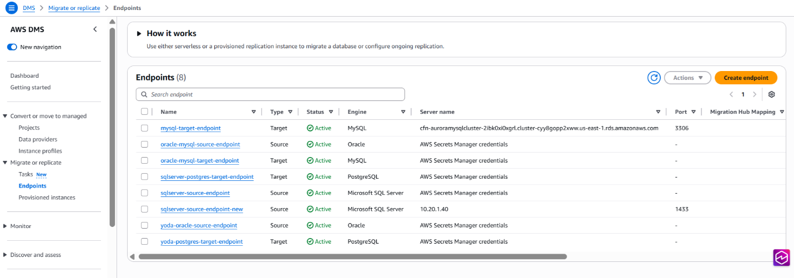

If Kiro/Q successfully built the endpoints, Please proceed to the next section. You don't need to do the part below unless you want the experience
Manual steps only if needed or you want the experience
Click on the Endpoints link on the left, and then click on Create endpoint on the top right corner.

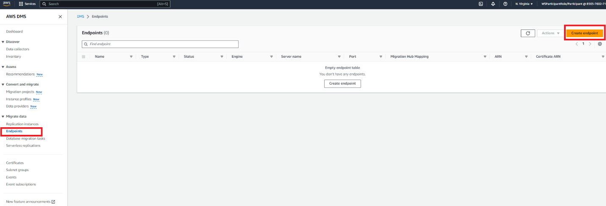

Enter the following information to create an endpoint for the source dms_sample database Please note the password is not provided below you need to goto Secrets Manager and open DMSDBSecret and reveal the SQL Server password (same as earlier if you've already done this). It is also on first Cloudformation Stack's output tab under password either SQL Server or Oracle depending on your source:
Note: expand only for the source in your scenario you can skip the other sources.
For Oracle Source expand here
For SQL Server Source expand here
Once the information has been entered, select the existing DMS Replcation instance (the one without your initials) and click Run Test. When the status turns to successful, click Create endpoint.
Follow the same steps to create another endpoint for the Target Aurora RDS Database (dms_sample_dbo or dms_sample depending on your source db) using the following values Please note the password is not provided below you need to goto Secrets Manager and open DMSDBSecret and reveal the SQL Server password. It is also on first Cloudformation Stack's output tab under SQL Server password (yes this is mysql but the passwords are the same for sql server & mysql in this case) :
| Parameter | Value |
| --- | --- |
| Endpoint Type | Target endpoint |
| Select RDS DB instance | Checked for all DB targets |
| Select RDS DB instance | <StackName>-AuroraMySQLInstance |
| Endpoint Identifier | aurora-mysql-target |
| Descriptive Amazon Resource Name(if there) | leave blank |
| Target Engine | Amazon Aurora MySQL |
| Access to Endpoint database Radio Button | Select/click Provide access information Manually |
| Server Name | TargetAuroraMySQLEndpoint or it should auto populate |
| Port | 3306 |
| SSL Mode | none |
| User Name | dbadmin |
| Password | See Cloudformation Output tab & DMSDBSecretP or look it up in AWS Secrets Manager |
| Test endpoint connection -> VPC | <VPC ID with DMSVpc in the name from Environment Setup Step> |
| Replication Instance | cfn-DMSReplication or DMSReplication or the one you created if it is ready |


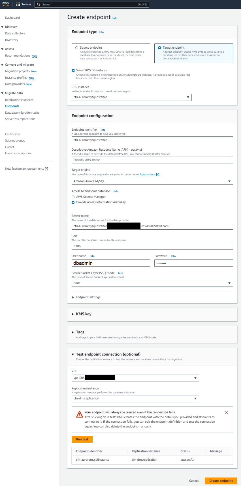

Once the information has been entered, select the existing DMS Replcation instance (the one without your initials) and click Run Test. When the status turns to successful, click Create endpoint.
If you are running the Serverless portion of this workshop please proceed Serverless main page vs. clicking next

### 12. Create and run the DMS migration task

We are now using Kiro/Q build all our DMS components. The first part of this section is verifying Kiro built them. If so you can ignore the rest of the manual steps unless you have time and want that experience.
For this migration, Kiro/Q should have already created the Database Migration Task but as this is a key step we do need to validate it.
Please select the DMS Task on left hand pane menu, then check the radio box beside the task Kiro created and go into Modify button on right side of screen
**Oracle**
**SQLServer**
For Oracle source it should look like

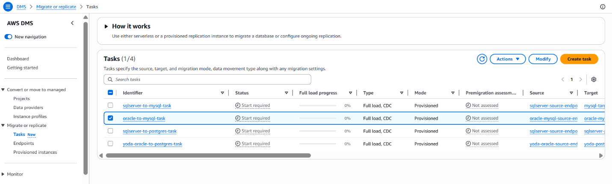

Please validate/check the following settings were set properly by Kiro/Q This is important as sometimes they aren't set right Overall Task Type should be Migrate and replicate Create recovery table on target DB On Target table preparation mode should be "Do nothing" Max Lob Size should be 102400 CloudWatch Logs should be enabled Data validation should be Unchecked Batch-optimized apply On
It should look like below pick the appropriate tab for your source
**Oracle**
**SQLServer**
For Oracle source it should look like Selection Criteria should be 'DMS_SAMPLE' for Oracle source and table name is like '%', include** Transformation rules for Oracle source should be Schema/Table/Column to lower case on target

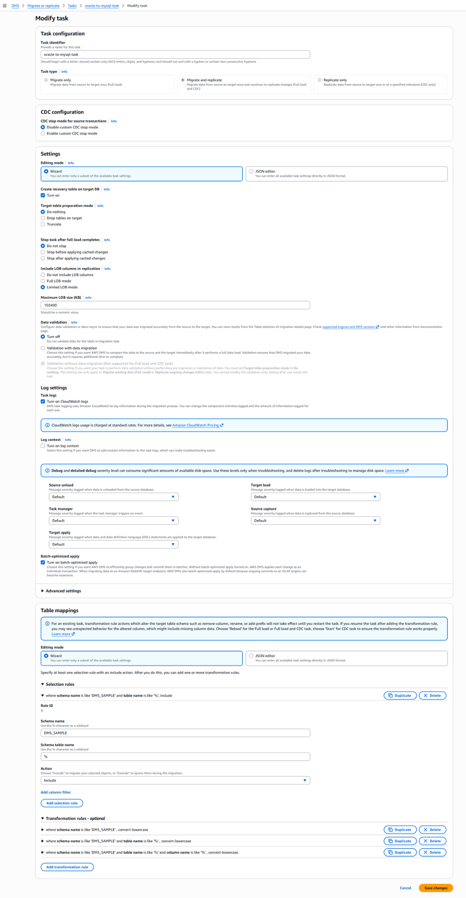

If everything looks good hit Cancel to get out of modify screen or if you had to make changes then Save
Let's start/run our task, check the radio box beside the Kiro/Q created task you just checked then select Actions button and Start to start your task. If a popup appears select Start or Yes to start your task
At this point, the task will start running and replicating data from the dms_sample or YODA database running on your source to the Amazon Aurora PostgreSQL instance. Note the DMS task will take a moment to transition into Status=Ready, followed by Status=Starting, and then Status=Running. You can use the circular arrow refresh button to update the status for the task. Please jump to step 9 in manual section below
Click on your task and scroll to the Table statistics tab to view the table statistics to see how many rows have been moved. It should look something like below

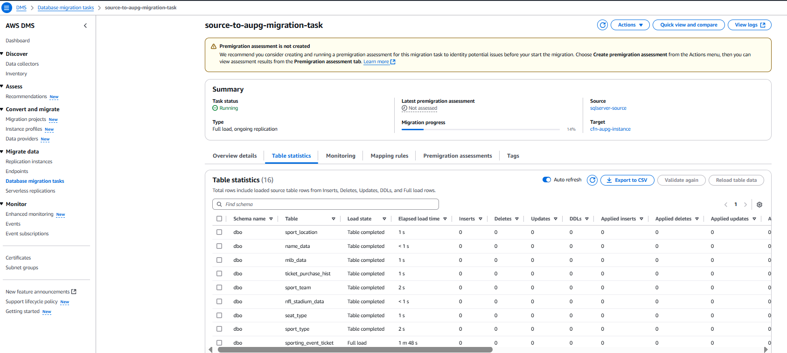

If there is an error, the status color changes from green to red. Click on View logs link for the logs to debug.
For Oracle source errors expand here
For SQL Server source errors expand here
If the task fails, ask Kiro/Q to analyze why the task failed and fix it for you or you can goto the DMS Task Overview tab in the AWS console and click on the CloudWatch link then search for "E:" to find errors. A common issue we've had in this workshop is when Kiro/Q runs SQL Server script the distributor gets miss configured or is installed twice. If this is the issue you have ask Kiro/Q to fix it and restart your task. If Kiro/Q can't fix the issue goto the SQL Server endpoint and add extra connection attribute "ignoreMsReplicationEnablement=true" retest the endpoint connection then restart the DMS Task.
If above was successful you can move on to the next section.
Again if Kiro/Q was successful skip below it is only here in case Kiro/Q has issues or if you want the manual experience
Manual steps only if needed or you want the experience
AWS DMS uses Database Migration Task to migrate the data from source to the target database.
Click on Database migration tasks on the left-hand menu, then click on the Create task button on the top right corner.

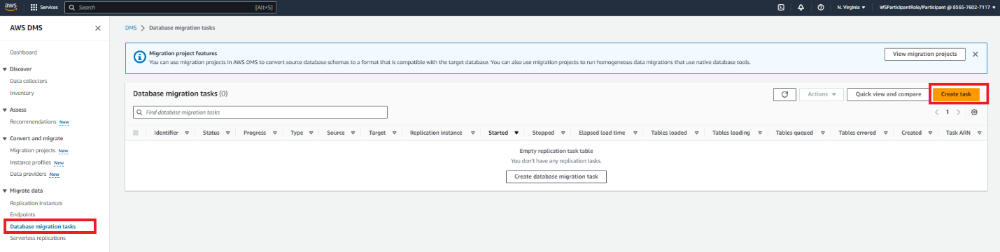

```sql
Create a data migration task with the following values for migrating the dms_sample database.
```
Be sure to select Do Nothing or you will have errors!!!!. Click on "Do Nothing for Target Table Preparation mode" button.
| Parameter | Value |
| --- | --- |
| Task identifier | source-to-AuroraMySQL-target |
| Descriptive Amazon Resource Name (ARN) | leave blank |
| Source database endpoint | your source database SQL Server or Oracle etc from prior step |
| Target database endpoint | aurora-target or cfn-auroramysqlinstance or whatever you named it in prior step |
| Task Mode | Provisioned |
| Replication instance | cfn-dmsreplication or just dmsreplication |
| Migration type | Migrate existing data and replicate ongoing changes |
| How long do you intend to continue replicating from source to target? | check Limited Time |
| CDC stop mode | Disable custom CDC stop mode |
| Edit Mode | Wizard checked |
| Create recovery table on target DB | checked |
| Target table preparation mode | Do nothing (not the default) |
| Stop task after full load completes | Don’t stop |
| LOB Column settings / Include LOB columns in replication | Limited LOB mode |
| Max LOB size (KB) | 104200 |
| Data Validation | Unchecked or Turned off checked |
| Task Logs / Enable CloudWatch logs | Check Enable CloudWatch logs (not the default) |
| Log Context | checked and take default levels on logging |
| Batch-optimized apply if visible | Turn on batched optimized apply Unchecked |

Expand the Table mappings section, and select Wizard for the editing mode.
Click on Add new selection rule button and enter the following values in the form:
Note: expand only for the source in your scenario you can skip the other sources.
For Oracle Source expand here
For SQL Server Source expand here
If the Create Task screen does not recognize any schemas, make sure to go back to endpoints screen and click on your endpoint. Scroll to the bottom of the page and click on Refresh Button (⟳) in the Schemas section. If your schemas still do not show up on the Create Task screen, click on the Guided tab and manually select ‘dbo’ schema and all tables.
Next, expand the Transformation rules section, and click on Add new transformation rule using the following values:
For Oracle Source expand here

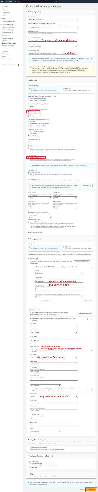

Uncheck Turn on premigration assessment this should collapse this section for our workshop this part there isn't time for and it isn't required.
After entering the values, make sure Migration task startup configuration is set to start Automatically on create, then click on Create task.
At this point, the task should start running and replicating data from the dms_sample database running on your source to the Amazon Aurora RDS (PostgreSQL) instance. Note the DMS task will take a moment to create (Status=creating), then it will transition into Status=Ready, followed by Status=Starting, and then Status=Running. You can use the circular arrow refresh button to update the status for the task.


As the rows are being transferred, you can monitor the task progress:
Click on your task (source-to-aupg-migration-task) and scroll to the Table statistics section to view the table statistics to see how many rows have been moved.
If there is an error, the status color changes from green to red. Click on View logs link for the logs to debug.
Note moving all the data will take several minutes. Once you see sports_type table is complete you can move onto the next step. You don't have to wait for the bigger tables like SPORTING_EVENT_TICKET to finish so please proceed to the next step.

### 13. Inspect the target database

We reset the step numbers for each subsection vs carrying them all the way through the DMS part so for this section we start at 1.
If you disconnected from the Source EC2 instance, follow the instruction in Connect to the EC2 Instance section from the previous part to RDP to the instance.
go back to Kiro/Q prompt window / tab (if you are familiar with Aurora Query Editor you can also use that interface to run the query below but Kiro maybe faster :-))
Inspect the migrated data, by querying one of the tables in the target database. For example, the following query should return a table with two rows:
Note: expand only for the source in your scenario you can skip the other sources.
For Oracle Source expand here
For SQL Server Source expand here
Baseball, and football are the only two sports that are currently listed in this table. In the next section you will insert several new records to the source database with information about other sport types. DMS will automatically replicate these new records from the source database to the target database.
Row count results should be 2 rows baseball & football same as picture above for Oracle source
If the task fails, ask Kiro/Q to analyze why the task failed and fix it for you or you can goto the DMS Task Overview tab in the AWS console and click on the CloudWatch link then search for "E:" to find errors. A common issue we've had in this workshop is when Kiro/Q runs SQL Server script the distributor gets miss configured or is installed twice. If this is the issue you have ask Kiro/Q to fix it and restart your task. If Kiro/Q can't fix the issue goto the SQL Server endpoint and add extra connection attribute "ignoreMsReplicationEnablement=true" retest the endpoint connection then restart the DMS Task.
Once Kiro/Q provides the "Baseball & Football" records/results like below you can skip the prior manual section below which is just here for reference or in case of an issue and proceed to the next section.


Below are steps to put Foreign keys back on target after full move. Due to time we will skip this and proceed to next section if you want to come back and apply foreign keys feel free to do so later
Note: putting the foreign keys back on the target is a normal step in the process and the steps below cover that however due to our short workship time we are going to skip that if you have time you can come back and have Kiro/Q run the add foreign key script below.
Manual steps only for reference if Kiro was not successful or you want the experience .
Go to/Return to Kiro Session Manager session and prompt/tell Kiro you have a MySQL Script you want to run
```sql
Use the following script that matches your source database selected to enable the foreign key constraints that we dropped earlier.
```
Note this will take a long time to complete you can move onto the next step while it is running. If errors occur they can be ignored or resolved later.
For Oracle Source expand here
For SQL Server Source expand here
Note this will take a long time to complete you can move onto the next step. If errors occur they can be ignored or resolved later.
Ensure Kiro starts and runs the script but you don't have to wait for it to be completely done before going to the next step
Go back to your Kiro/Q prompt and run the following command.
Run the following SQL script against the SQL Server source database and return the results:
```sql
USE [dms_sample]
GO
INSERT INTO [dbo].[sport_type]
([name]
```
,[description])
```sql
VALUES
('hockey', 'A sport in which two teams play against each other by trying to more a puck into the opponents goal using a hockey stick');
INSERT INTO [dbo].[sport_type]
([name]
```
,[description])
```sql
VALUES
('basketball', 'A sport in which two teams of five players each that oppose one another shoot a basketball through the defenders hoop');
INSERT INTO [dbo].[sport_type]
([name]
```
,[description])
```sql
VALUES
('soccer','A sport played with a spherical ball between two teams of eleven players');
INSERT INTO [dbo].[sport_type]
([name]
```
,[description])
```sql
VALUES
('volleyball','two teams of six players are separated by a net and each team tries to score by grounding a ball on the others court');
INSERT INTO [dbo].[sport_type]
([name]
```
,[description])
```sql
VALUES
('cricket','A bat-and-ball game between two teams of eleven players on a field with a wicket at each end');
GO
;
```
For SQL Server Source Next prompt for Kiro/Q
1
Re-run the Aurora MySQL query on the dms_sample_dbo.sport_type table to verify DMS task replication is working. Confirm there are now 7 rows.
there should now be 7 rows in our Aurora MySQL target


Congratulations you completed this section and your database migration!!!

## Images

The original Word document contained **53 embedded images**. All extracted images are included in `images/` and linked in the procedure above.

## Safety and cleanup

- Keep `.pem` key files, database passwords, Secrets Manager values, and access tokens out of Git. Add local secret files to `.gitignore`.
- Review IAM permissions, security groups, routing, encryption, backup retention, and database parameter settings before production use.
- Confirm source/target engine versions, supported AWS DMS features, LOB settings, table mappings, CDC prerequisites, and endpoint connectivity.
- Validate row counts, data types, constraints, indexes, stored procedures, views, triggers, routines, and application behavior after migration. The workshop explicitly notes that DMS data migration does not migrate all schema objects.
- Stop the DMS task only after cutover criteria are met; capture final CDC lag and reconcile writes before switching applications.
- Delete lab resources only after confirming that the environment is no longer needed. Review CloudFormation stack dependencies and data retention before deleting.

## Source

Prepared from the uploaded file: `MS Sql to Aurora Mysql AWS Database Migration Workshop.docx` (68 pages). The steps and examples above reflect that source; the notes section highlights material ambiguities rather than changing the source content.
